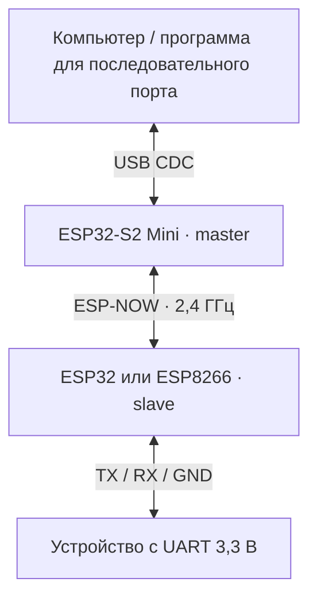

# AirWireCom

[English version](README.md)

AirWireCom передаёт последовательные данные между двумя ESP-платами по ESP-NOW. Компьютер подключается к первой плате через USB, вторая соединяется с UART устройства. Обе платы работают на одной прошивке; нажатие кнопки определяет, какая из них управляет связью и скоростью UART.



Мост передаёт двоичные данные в обе стороны, сохраняет пару после перезапуска и передаёт изменения скорости от master к slave. Он заменяет последовательный кабель для терминала, управляющей программы или сбора данных.

## Инженерные решения

| Задача | Реализация | Результат |
|---|---|---|
| Одна прошивка для обоих концов | Поиск начинается при включении; нажатие на плате у компьютера назначает её master | Роли выбираются при сопряжении без отдельного образа прошивки |
| Согласовать UART устройства с настройками компьютера | S2 читает скорость из USB CDC line coding и передаёт её служебным пакетом | Программа на компьютере задаёт скорость удалённого UART |
| Поддержать разные ESP-платы | Общий протокол с адаптациями USB/UART, ESP-NOW и flash | S2 использует встроенный USB, ESP32 и ESP8266 — UART0 |
| Восстановить известное соединение | Роль, MAC партнёра и скорость сохраняются во flash; heartbeat управляет LED | После перезапуска восстанавливаются пара и скорость UART; потеря связи сохраняет пару |

Пакет данных содержит до **249 байт последовательного потока**. Текущий протокол отправляет данные и изменения скорости однократно, без повторов на уровне приложения и управления потоком. [Инструмент loopback](docs/DEVELOPMENT.RU.md#измерение-loopback) измеряет принятые байты, время прохождения туда и обратно и полезную скорость на реальном стенде.

## Первый запуск

В примере **ESP32-S2 Mini работает как master**, а **ESP32 DevKit или ESP8266 NodeMCU — как UART slave**. У S2 порт данных в обеих ролях — USB CDC.

1. Установка PlatformIO Core 6.2.0 описана в [руководстве по сборке](docs/DEVELOPMENT.RU.md#сборка-и-прошивка).
2. Команды сборки и прошивки плат; имена портов заменяются на локальные:

   ```bash
   pio run -e s2mini -t upload --upload-port /dev/ttyACM0
   pio run -e esp8266 -t upload --upload-port /dev/ttyUSB0
   ```

   Для ESP32 slave вместо `-e esp8266` используется `-e esp32`.

3. Соединения slave: **TX GPIO1 → RX устройства**, **RX GPIO3 ← TX устройства**, **GND → GND**. Логические уровни UART — 3,3 В. Светодиоды, RX Monitor и подключение USB-UART описаны в [схеме подключения](docs/DEVELOPMENT.RU.md#подключение).
4. После включения обе платы автоматически ищут партнёра. Когда LED платы S2 у компьютера мигает двойными вспышками, однократное нажатие её кнопки назначает её master. Вторая плата становится slave.
5. В программе на компьютере выбираются USB-порт S2 и скорость UART устройства. При обмене с партнёром LED горит постоянно. Удержание кнопки **3 секунды** удаляет пару.

## Проверки

В репозитории есть регрессионные тесты, которые выполняют прошивку с имитацией периферии на компьютере, тесты измерительного скрипта и CI для всех шести обычных и отладочных сборок:

```bash
python3 tests/run_host_tests.py
python3 -m unittest discover -s scripts -p 'test_*.py'
pio run
```

Локальная проверка с закреплёнными версиями: **все шесть сборок прошивки и оба набора тестов проходят**. Целевые сборки: `s2mini`, `esp32`, `esp8266` и варианты с суффиксом `_debug`. Отладочные сообщения идут в порт данных; двоичный обмен и измерения выполняются на обычной сборке. Порядок физических измерений приведён в руководстве ниже.

## Документация

- [Архитектура и протокол](docs/ARCHITECTURE.RU.md): состояния сопряжения, форматы пакетов, скорость, хранение и платформенные адаптации.
- [Сборка, подключение и измерения](docs/DEVELOPMENT.RU.md): закреплённые версии, выбор портов, loopback и диагностика.
- [Прошивка](src/main.cpp) и [лицензия](LICENSE).
