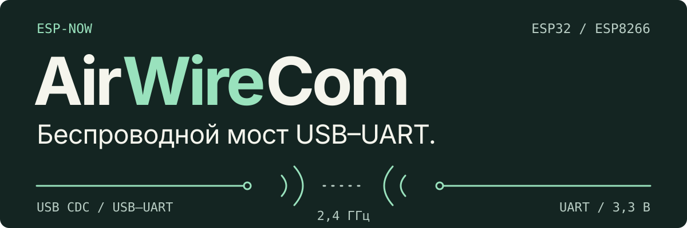
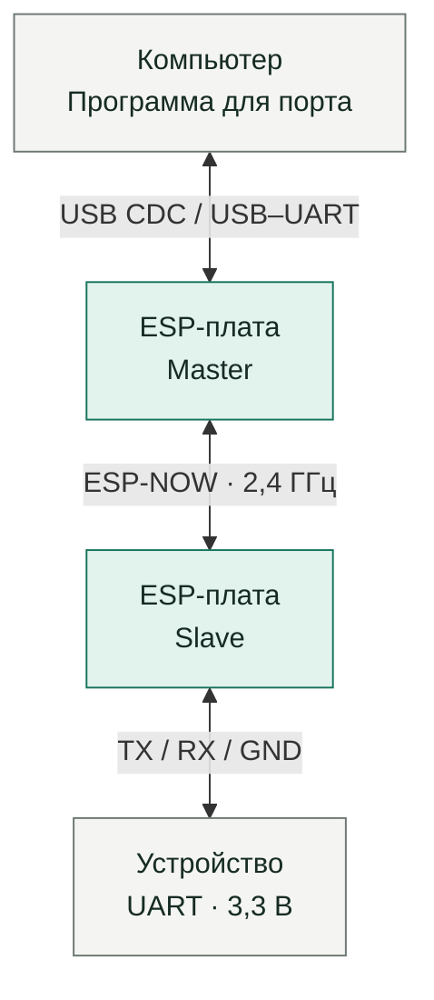

<p align="center"><a href="README.md">English</a> · <strong>Русский</strong></p>

<h1></h1>

AirWireCom передаёт последовательные данные между двумя **ESP-платами** по **ESP-NOW**. Компьютер подключается через **встроенный USB CDC или USB–UART-преобразователь**, а удалённая плата — к **UART устройства с логикой 3,3 В**. Мост передаёт двоичные данные в обе стороны для терминалов, управляющих программ и сбора данных.

[Первый запуск](#первый-запуск) · [Проверки](#проверки) · [Документация](#документация) · [Лицензия MIT](LICENSE)

## Как это работает



На обеих платах — одна и та же прошивка, собранная для соответствующего типа платы. Модель платы не определяет её роль: нажатие кнопки на плате у компьютера назначает её master; вторая становится slave. Пара и скорость UART сохраняются после перезапуска.

## Инженерные решения

- **Одна прошивка, две роли.** Поиск партнёра начинается при включении. Роли выбираются во время сопряжения, отдельный образ для master или slave не нужен.
- **Синхронизация скорости при обоих способах подключения.** USB CDC сообщает запрошенную скорость напрямую; UART master оценивает её через вход RX Monitor. Master передаёт скорость slave служебным пакетом.
- **Общий протокол для ESP-плат.** Платформенные адаптации обслуживают USB/UART, ESP-NOW и flash. Готовые сборки есть для ESP32, ESP8266 и ESP32-S2 Mini; USB CDC необязателен.
- **Потеря связи не сбрасывает пару.** Роль, MAC партнёра и скорость хранятся во flash. Индикатор показывает обмен с партнёром. Если партнёр пропал из эфира, сохранённая пара остаётся.

### Ограничения канала

Пакет данных содержит до **249 байт последовательного потока**. Формат UART — **8N1**; изменения чётности, стоповых битов и сигналы управления модемом не передаются. Данные и изменения скорости отправляются однократно, без повторов на уровне приложения и управления потоком. Шифрование радиоканала отключено. Подробности — в [описании протокола и работы со скоростью](docs/ARCHITECTURE.RU.md).

## Первый запуск

Для обоих концов выбираются ESP-платы с **ESP-NOW** и нужным последовательным интерфейсом. **ESP32-S2 использовалась при тестировании**; роль master доступна и другим платам. ESP32 и ESP8266 подключаются к компьютеру через встроенный или внешний USB–UART-преобразователь. Для другой платы выбираются соответствующие настройки сборки и GPIO — см. [руководство по сборке](docs/DEVELOPMENT.RU.md#сборка-и-прошивка).

1. Установка **PlatformIO Core 6.2.0** описана в [руководстве по сборке](docs/DEVELOPMENT.RU.md#сборка-и-прошивка).
2. Команды сборки и прошивки плат; имена портов заменяются на локальные:

   ```bash
   pio run -e esp32 -t upload --upload-port /dev/ttyUSB0
   pio run -e esp8266 -t upload --upload-port /dev/ttyUSB1
   ```

   В командах показана пара ESP32 и ESP8266; любая из них может стать master. Для варианта S2 Mini со встроенным USB используется `-e s2mini` и найденный порт, например `/dev/ttyACM0`.

3. Плата у компьютера подключается через встроенный USB CDC или USB–UART-преобразователь. Для UART master TX преобразователя соединяется с **GPIO3 и RX Monitor** (**GPIO4 у ESP32**, **GPIO14 у ESP8266**); RX преобразователя — с **GPIO1**, **GND** — общий. Для встроенного USB CDC провод RX Monitor не нужен.

4. Соединения slave с устройством:

   | Slave | Устройство |
   |---|---|
   | TX · GPIO1 | RX |
   | RX · GPIO3 | TX |
   | GND | GND |

   Логические уровни UART — **3,3 В**. Светодиоды, RX Monitor, согласование уровней и USB-UART описаны в [схеме подключения](docs/DEVELOPMENT.RU.md#подключение).

5. После включения обе платы ищут партнёра. Когда LED платы у компьютера мигает **двойными вспышками**, однократное нажатие её кнопки назначает её master. Вторая плата становится slave.
6. В программе на компьютере выбираются последовательный порт платы и скорость UART устройства. USB CDC сообщает скорость напрямую; UART-вариант определяет её по передаваемым данным с учётом [ограничений детектора](docs/ARCHITECTURE.RU.md#работа-со-скоростью). При обмене с партнёром LED горит постоянно. Удержание кнопки **3 секунды** удаляет пару.

## Проверки

| Прошивка | Loopback | Сборки |
|---|---|---|
| **51** проверка | **13** Python-тестов | **6** вариантов |

Регрессионные тесты выполняют прошивку с имитацией периферии на компьютере. [Firmware CI](https://github.com/mzaprudin/AirWireCom/actions/workflows/firmware.yml) запускает оба набора тестов и собирает все шесть вариантов; готовые прошивки доступны в артефактах запусков.

```bash
python3 tests/run_host_tests.py
python3 -m unittest discover -s scripts -p 'test_*.py'
pio run
```

С закреплёнными версиями инструментов проходят все шесть сборок и оба набора тестов. Целевые сборки: `s2mini`, `esp32`, `esp8266` и варианты с суффиксом `_debug`. Отладочные сообщения идут в порт данных; для двоичного обмена и измерений используется **обычная сборка**.

На реальном стенде [инструмент loopback](docs/DEVELOPMENT.RU.md#измерение-loopback) проверяет возвращённые байты, измеряет время прохождения туда и обратно и полезную скорость. В репозитории есть порядок проверки и инструмент; количественные аппаратные измерения пока не опубликованы.

## Документация

- [Архитектура и протокол](docs/ARCHITECTURE.RU.md) — состояния сопряжения, форматы пакетов, скорость, хранение и платформенные адаптации.
- [Сборка, подключение и измерения](docs/DEVELOPMENT.RU.md) — закреплённые версии, выбор портов, loopback и диагностика.
- [Исходный код прошивки](src/main.cpp) · [Лицензия MIT](LICENSE).
