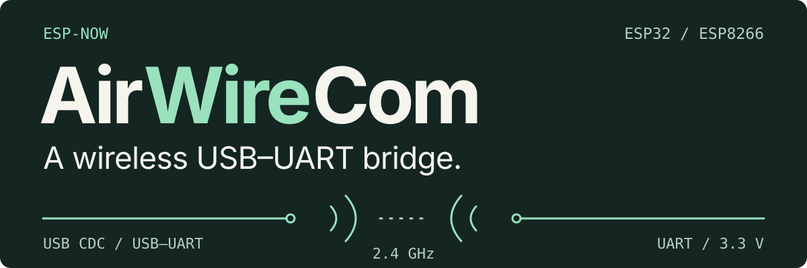
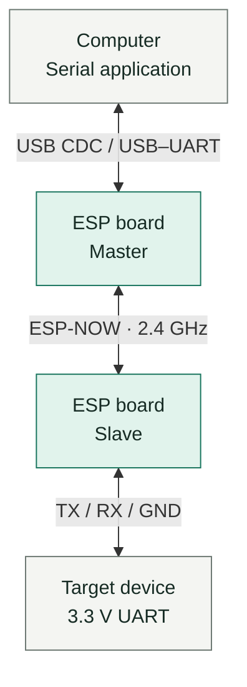

<p align="center"><strong>English</strong> · <a href="README.RU.md">Русский</a></p>

<h1></h1>

AirWireCom carries serial data between two **ESP boards** over **ESP-NOW**. Connect the computer through **native USB CDC or a USB–UART adapter**, and the remote board to the device's **3.3 V UART**. The bridge forwards binary data in both directions for terminals, controllers and data loggers.

[First run](#first-run) · [Verification](#verification) · [Documentation](#documentation) · [MIT license](LICENSE)

## How it works



Both boards run the same firmware, built for their board type. The board model does not determine its role: a button click on the host-side board chooses the master; the other board becomes the slave. The pair and baud rate survive a restart.

## Engineering decisions

- **One firmware, two roles.** Discovery starts at power-on. Roles are chosen during pairing, so a separate master or slave firmware image is unnecessary.
- **Baud synchronization with either host interface.** USB CDC reports the requested speed directly; a UART master estimates it through the RX Monitor input. The master sends the speed to the slave in a control packet.
- **A shared protocol across ESP boards.** Platform adapters handle USB/UART, ESP-NOW and flash storage. The ready-made builds cover ESP32, ESP8266 and ESP32-S2 Mini; USB CDC is optional.
- **Pairing survives a lost connection.** Flash stores the role, peer MAC and baud rate. Peer traffic drives the status LED; a missing peer leaves the saved pair intact.

### Link limits

Each data packet holds up to **249 serial bytes**. UART framing is **8N1**; parity, stop-bit changes and modem-control signals are not forwarded. Data and baud updates are sent once, without application retries or flow control. Radio encryption is disabled. See [protocol and baud handling](docs/ARCHITECTURE.md) for the full behavior.

## First run

Choose ESP boards with **ESP-NOW** and the serial interface needed at each end. **ESP32-S2 was used for testing**; it is not required as master. ESP32 and ESP8266 can connect to the computer through a built-in or external USB–UART adapter. For another board, select the matching build and GPIO settings in the [build guide](docs/DEVELOPMENT.md#build-and-upload).

1. Install **PlatformIO Core 6.2.0** using the [build guide](docs/DEVELOPMENT.md#build-and-upload).
2. Build and flash each board. Replace the sample ports with local device names:

   ```bash
   pio run -e esp32 -t upload --upload-port /dev/ttyUSB0
   pio run -e esp8266 -t upload --upload-port /dev/ttyUSB1
   ```

   These commands illustrate an ESP32 and an ESP8266; either can be master. For the S2 Mini native USB variant, use `-e s2mini` and its detected port, such as `/dev/ttyACM0`.

3. Connect the host-side board through native USB CDC or a USB–UART adapter. For a UART master, adapter TX goes to **GPIO3 and RX Monitor** (**GPIO4 on ESP32**, **GPIO14 on ESP8266**); adapter RX goes to **GPIO1**, with a shared **GND**. Native USB CDC needs no RX Monitor wire.

4. Wire the slave to the target:

   | Slave | Target device |
   |---|---|
   | TX · GPIO1 | RX |
   | RX · GPIO3 | TX |
   | GND | GND |

   UART uses **3.3 V logic**. The [wiring guide](docs/DEVELOPMENT.md#wiring) covers LEDs, RX Monitor, level conversion and USB-UART connections.

5. Power both boards. When the host-side board's LED **double-blinks**, click its button once to make it master. The other board becomes slave.
6. Open the host-side serial port in the application and select the device's baud rate. USB CDC reports the rate directly; the UART variant detects it from transmitted data, with the [baud-detection limits](docs/ARCHITECTURE.md#baud-handling). The LED stays on while receiving peer traffic. Hold the button for **3 seconds** to remove the pair.

## Verification

| Firmware | Loopback tool | Builds |
|---|---|---|
| **51** host checks | **13** Python tests | **6** environments |

The host regressions execute the firmware with simulated peripherals. [Firmware CI](https://github.com/mzaprudin/AirWireCom/actions/workflows/firmware.yml) runs both test suites and builds all six environments, with firmware available as workflow artifacts.

```bash
python3 tests/run_host_tests.py
python3 -m unittest discover -s scripts -p 'test_*.py'
pio run
```

The pinned toolchain passes all six builds and both test suites. Targets are `s2mini`, `esp32`, `esp8266` and their `_debug` variants. Debug messages share the data port; use a **release build** for binary traffic and measurements.

For a real setup, the [loopback tool](docs/DEVELOPMENT.md#loopback-measurement) checks echoed bytes and measures round-trip time and useful throughput. The repository includes the procedure and tool; quantitative hardware measurements have not been published yet.

## Documentation

- [Architecture and protocol](docs/ARCHITECTURE.md) — pairing states, packet format, baud handling, storage and platform adapters.
- [Build, wiring and measurements](docs/DEVELOPMENT.md) — pinned toolchain, serial ports, loopback procedure and troubleshooting.
- [Firmware source](src/main.cpp) · [MIT license](LICENSE).
