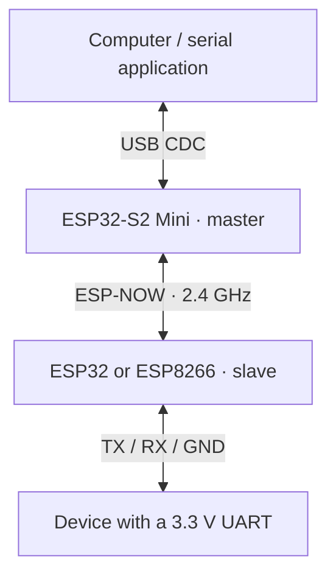

# AirWireCom

[Русская версия](README.RU.md)

AirWireCom carries serial data between two ESP boards over ESP-NOW. A computer connects to the first board over USB; the second board connects to a device's UART. Both boards run the same firmware, and a button confirms which one controls the link and its baud rate.



The bridge forwards binary data in both directions, remembers the paired board across restarts, and sends baud changes from master to slave. It can replace the serial cable used by a terminal, controller, or data logger.

## Engineering decisions

| Problem | Implementation | Result |
|---|---|---|
| Use one firmware for both ends | Discovery starts at power-on; a click on the host-side board makes it master | Roles are chosen during pairing without a separate firmware image |
| Keep the remote UART aligned with the host | S2 reads USB CDC line coding and sends the baud as a control packet | The host application sets the remote UART speed |
| Support different Espressif boards | Shared protocol with USB/UART, ESP-NOW and flash adapters | S2 uses native USB; ESP32 and ESP8266 use UART0 |
| Recover a known connection | Store role, peer MAC and baud in flash; heartbeat drives the LED | Restart restores the pair and UART speed; a missing peer remains paired |

Data packets carry up to **249 serial bytes**. The current protocol sends data and baud updates once, with no application retries or flow control. The [loopback tool](docs/DEVELOPMENT.md#loopback-measurement) measures received bytes, round-trip time and useful throughput on a real setup.

## First run

The example uses an **ESP32-S2 Mini as master** and an **ESP32 DevKit or ESP8266 NodeMCU as UART slave**. On S2 the data port is USB CDC in both roles.

1. Install PlatformIO Core 6.2.0 as described in the [build guide](docs/DEVELOPMENT.md#build-and-upload).
2. Build and flash each board; replace the sample ports with local device names:

   ```bash
   pio run -e s2mini -t upload --upload-port /dev/ttyACM0
   pio run -e esp8266 -t upload --upload-port /dev/ttyUSB0
   ```

   For an ESP32 slave, use `-e esp32` instead of `-e esp8266`.

3. Connect the slave's **TX GPIO1 → device RX**, **RX GPIO3 ← device TX**, and **GND → GND**. The UART uses 3.3 V logic. See the [wiring guide](docs/DEVELOPMENT.md#wiring) for LEDs, RX Monitor and USB-UART connections.
4. Power both boards. Discovery runs automatically. When the host-side S2 LED double-blinks, click its button once. That board becomes master; the other becomes slave.
5. Open the S2 USB serial port in the host application and select the device's baud rate. Paired boards show a steady LED while receiving peer traffic. Holding the button for **3 seconds** removes the pair.

## Verification

The repository includes host regressions that execute the firmware with simulated peripherals, tests for the measurement tool, and a CI matrix for all six release/debug environments:

```bash
python3 tests/run_host_tests.py
python3 -m unittest discover -s scripts -p 'test_*.py'
pio run
```

Verified locally with the pinned toolchain: **all six firmware builds and both test suites pass**. The targets are `s2mini`, `esp32`, `esp8266` and their `_debug` variants. Debug messages share the serial data port; use a release build for binary traffic and measurements. The guide below describes physical measurements.

## Documentation

- [Architecture and protocol](docs/ARCHITECTURE.md): pairing states, packet format, baud handling, storage and platform adapters.
- [Build, wiring and measurements](docs/DEVELOPMENT.md): pinned toolchain, serial ports, loopback procedure and troubleshooting.
- [Firmware](src/main.cpp) and [license](LICENSE).
