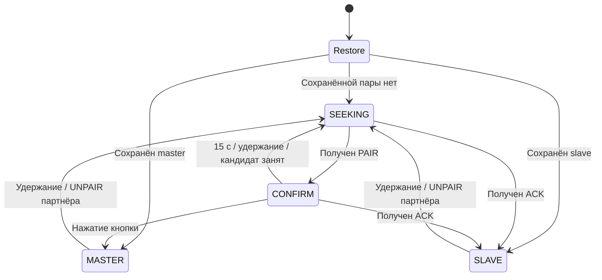

# Архитектура и протокол

[English version](ARCHITECTURE.md) · [Обзор проекта](../README.RU.md)

## Тракт данных и платформы

`dataLoop()` читает до 249 доступных байт из `Serial`, добавляет тип пакета и отправляет пакет ESP-NOW. Обработчик входящего `DATA` записывает полезную нагрузку в локальный последовательный порт. Формат UART — 8N1. Master со встроенным USB CDC получает скорость из USB line coding; UART master оценивает её по сигналу TX компьютера. Чётность, стоповые биты и сигналы управления модемом по мосту не передаются.

Роль выбирается при сопряжении и не зависит от модели платы. Компьютер подключается через встроенный USB CDC либо встроенный или внешний USB–UART-преобразователь. Ниже перечислены готовые конфигурации плат; для других подходящих ESP-плат выбираются соответствующие платформа, плата и GPIO.

| Сборка | Локальный порт данных | Хранение | Радиоинтерфейс |
|---|---|---|---|
| `s2mini` | Встроенный USB CDC, интерфейс 0 | Preferences / NVS | ESP32 `esp_now.h` |
| `esp32` | UART0, TX GPIO1 / RX GPIO3 | Preferences / NVS | ESP32 `esp_now.h` |
| `esp8266` | UART0, TX GPIO1 / RX GPIO3 | Эмуляция EEPROM | ESP8266 `espnow.h`, роль COMBO |

У каждой сборки есть вариант `_debug`. В сборке `s2mini` USB CDC используется в обеих ролях: назначение slave не переключает порт данных на UART. Для устройства с UART выбирается сборка с портом данных UART, например `esp32` или `esp8266`.

ESP-NOW работает в режиме Wi-Fi station. Канал партнёра `0` означает текущий канал Wi-Fi; обе платы должны работать на одном канале. Шифрование отключено. Проверка MAC выделяет сопряжённого отправителя для данных и команд установленного соединения; криптографической аутентификации она не даёт.

## Поиск и сопряжение

Для первого соединения достаточно включить обе платы и нажать кнопку на плате у компьютера:

1. **Включение.** Платы без сохранённой пары автоматически ищут друг друга. Во время поиска LED плавно меняет яркость.
2. **Подтверждение.** Когда LED платы у компьютера мигает двойными вспышками, короткое нажатие её кнопки назначает её **master**. Нажатие должно произойти в течение **15 секунд после начала двойных вспышек**. Удалённая плата становится **slave** автоматически; на ней нажимать кнопку не требуется.
3. **Работа.** В программе на компьютере выбираются последовательный порт и скорость устройства. Платы передают данные в обе стороны.

Если 15 секунд прошли без нажатия, поиск начинается заново. Пара, роли и скорость сохраняются: **после обычного перезапуска повторять сопряжение не нужно**.

Для смены пары кнопка на каждой из двух плат удерживается **3 секунды**, затем отпускается. Платы снова переходят к поиску. Если плата уже ждёт подтверждения, такое удержание отклоняет найденного кандидата.

Если плата **35 секунд не слышит партнёра**, LED начинает быстро мигать. Сохранённая пара остаётся; после возвращения партнёра связь возобновляется без нажатия кнопок.

| LED | Значение |
|---|---|
| Плавно меняет яркость | Поиск другой платы |
| Мигает двойными вспышками | Найдена плата; ожидается подтверждение |
| Горит постоянно | Пара установлена, обычный режим работы |
| Быстро мигает | Давно нет пакетов от партнёра; пара сохранена |

У ESP8266 LED активен низким уровнем. Для ESP32-плат на GPIO15 может потребоваться внешний светодиод.

Служебные пакеты, состояния и интервалы

1. Плата без пары рассылает `PAIR` при запуске, затем каждые **2 секунды** в `SEEKING` и `CONFIRM`.
2. Первый `PAIR`, принятый в `SEEKING`, сохраняет MAC кандидата, запускает окно подтверждения **15 секунд** и включает двойные вспышки LED.
3. Нажатие кнопки в `CONFIRM` назначает плату master. Она рассылает `CLAIM` с **MAC выбранного slave**, затем отправляет этому slave пакет `ACK` со скоростью.
4. Плата, получившая `ACK` во время поиска, становится slave и применяет скорость. Второго нажатия кнопки не требуется.
5. Другая плата, ожидавшая занятого кандидата, возвращается в `SEEKING`. Удержание **3 секунды** отклоняет кандидата или удаляет установленную пару. При удалении пары прошивка также отправляет партнёру `UNPAIR`; сброс на обеих платах позволяет начать заново, даже если этот пакет не дошёл.

`Restore` обозначает выбор при запуске. Четыре состояния прошивки: `ST_SEEKING`, `ST_CONFIRM`, `ST_PAIRED_MASTER` и `ST_PAIRED_SLAVE`.

Master отправляет `PING` каждые **30 секунд**. Обе сопряжённые роли отвечают на `PING` партнёра пакетом `PONG`; после загрузки сохранённой пары каждая роль также сразу отправляет `PING`. Принятые пакеты партнёра обновляют время последнего контакта. Через **35 секунд** без входящих пакетов партнёра LED быстро мигает. Плата сохраняет роль и пару и продолжает пересылку данных. После возобновления входящего обмена LED снова горит постоянно.

При поиске яркость LED плавно меняется за **2 секунды**; подтверждение обозначается двумя вспышками по **120 мс** за **1,2 секунды**; отсутствие контакта — чередованием **200 мс включён / 200 мс выключен**. После сопряжения или восстановления пары LED сначала горит постоянно в течение начального окна ожидания; это само по себе не подтверждает доставку данных.

## Формат пакетов

Пакет начинается с однобайтового типа. Полная полезная нагрузка радиопакета занимает до 250 байт; последовательные данные `DATA` используют до 249. Скорость кодируется беззнаковым 32-битным числом little-endian.

| Код | Имя | Получатель | Полезная нагрузка |
|---|---|---|---|
| `0x01` | `DATA` | Партнёр, в обе стороны | 1–249 байт последовательных данных |
| `0x02` | `PAIR` | Все устройства | Нет |
| `0x03` | `CLAIM` | Все устройства | MAC выбранного slave, 6 байт |
| `0x04` | `ACK` | Выбранный slave | Скорость, 4 байта |
| `0x05` | `UNPAIR` | Партнёр | Нет |
| `0x06` | `BAUD` | Slave | Скорость, 4 байта |
| `0x07` | `PING` | Партнёр | Нет |
| `0x08` | `PONG` | Партнёр | Нет |

Правила приёма отклоняют пустые, слишком большие и неизвестные пакеты. Для `DATA`, `UNPAIR`, `PING` и `PONG` нужны состояние установленной пары и MAC сохранённого партнёра; для `BAUD` — дополнительно роль slave. `ACK` сопряжения принимается в `SEEKING` и `CONFIRM`. В `CLAIM`, `ACK` и `BAUD` должны присутствовать все обязательные поля.

`ACK` подтверждает сопряжение. У последовательного `DATA` нет подтверждения на уровне приложения, номера последовательности и повторной отправки. `BAUD` отправляется однократно при обнаруженном изменении скорости. Потеря служебного пакета может оставить разные скорости на концах. Аппаратные линии управления потоком UART мост не передаёт.

## Работа со скоростью

Начальная скорость — **115200 бод**. Master выбирает скорость и передаёт её в `ACK` и последующих `BAUD`. Slave применяет ненулевое значение локально и сохраняет его. При запуске применяется сохранённая скорость UART; UART master также применяет обнаруженную скорость локально перед её передачей slave.

**Встроенный USB CDC (`s2mini`):** `getHostBaud()` читает line coding USB CDC интерфейса 0 через TinyUSB. Скорость запрашивает программа на компьютере; USB передаёт байты независимо от битовых интервалов UART. Нулевое значение заменяется на 115200.

**UART (`esp32` / `esp8266`):** отдельный GPIO RX Monitor измеряет интервалы между фронтами сигнала TX компьютера. Его нужно физически соединить с тем же сигналом, что приходит на RX GPIO3. Самый короткий зарегистрированный импульс длительностью не менее **5 мкс** преобразуется в скорость и округляется до ближайшего значения из ряда:

`9600, 19200, 38400, 57600, 115200, 230400, 250000, 500000, 1000000`.

Эта оценка по сигналу зависит от передаваемого битового рисунка. Минимальный импульс хранится до перезапуска, поэтому последующее снижение скорости компьютера определяется ненадёжно. Порог 5 мкс также ограничивает распознавание высоких скоростей из списка. USB CDC удобен тем, что сообщает запрошенное значение напрямую и не требует провода RX Monitor; USB–UART-преобразователь использует описанный выше тракт UART.

## Хранение и расположение кода

Обе реализации сохраняют роль, MAC партнёра и скорость после сопряжения и изменения скорости. Удаление пары очищает запись.

| Платформа | Формат |
|---|---|
| ESP32 / S2 | Пространство Preferences `awc`: `role` (`M`/`S`), `peer` (6 байт), `baud` (`uint32`) |
| ESP8266 | Область EEPROM 16 байт: маркер `0xAB` по адресу 0, роль — 1, MAC — 2–7, скорость — 8–11 |

Сохранённые MAC и роль восстанавливают связь с выбранной платой. При запуске LED допускает обычный интервал ожидания контакта; его свечение не подтверждает доставку данных.

- [`src/main.cpp`](../src/main.cpp): платформенные адаптации, хранение, обработчики serial/radio и периодические задачи.
- [`include/AirWireProtocol.h`](../include/AirWireProtocol.h): константы пакетов, состояния, правила приёма и кодирование little-endian.
- [`src/tusb_config.h`](../src/tusb_config.h): конфигурация TinyUSB для S2; RX/TX CDC — по 256 байт.
- [`tests/`](../tests/): регрессионные проверки прошивки на компьютере с имитацией периферии.
- [`scripts/`](../scripts/): измерение serial loopback и тесты инструмента.

На ESP32 callback ESP-NOW выполняет операции с serial и flash параллельно периодическим задачам `loop()`. При дальнейшем развитии пропускной способности и конкурентной обработки эти операции можно перенести в ограниченную очередь.
