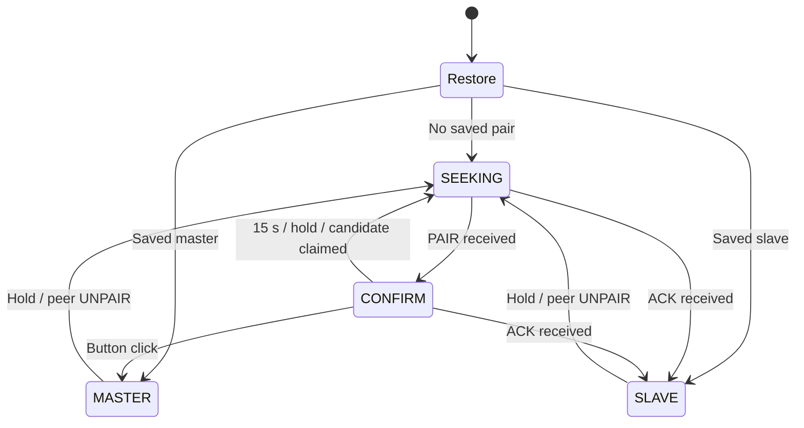

# Architecture and protocol

[Русская версия](ARCHITECTURE.RU.md) · [Project overview](../README.md)

## Serial path and platforms

`dataLoop()` reads up to 249 available bytes from `Serial`, prepends a packet type, and sends one ESP-NOW packet. Incoming `DATA` writes its payload to the local serial port. UART framing is 8N1. A native USB CDC master reads the requested baud from USB line coding; a UART master estimates it from the host TX signal. Parity, stop bits and modem-control signals are not forwarded.

The role is chosen during pairing and does not depend on the board model. A computer can connect through native USB CDC or a built-in/external USB–UART adapter. The environments below are ready-made board configurations; other suitable ESP boards need matching platform, board and GPIO settings.

| Environment | Local data port | Persistence | Radio API |
|---|---|---|---|
| `s2mini` | Native USB CDC, interface 0 | Preferences / NVS | ESP32 `esp_now.h` |
| `esp32` | UART0, TX GPIO1 / RX GPIO3 | Preferences / NVS | ESP32 `esp_now.h` |
| `esp8266` | UART0, TX GPIO1 / RX GPIO3 | EEPROM emulation | ESP8266 `espnow.h`, COMBO role |

Each environment has a `_debug` build. The `s2mini` build uses USB CDC in either role: assigning it slave does not switch its data port to UART. For a target connected by UART, choose a UART data-port build such as `esp32` or `esp8266`.

ESP-NOW runs in Wi-Fi station mode. Peer channel `0` uses the current Wi-Fi channel; both boards must share that channel. Encryption is disabled. A MAC check selects the paired sender for data and connected-state commands; it does not provide cryptographic authentication.

## Discovery and pairing

For the first connection, power both boards and press the button on the host-side board:

1. **Power on.** Boards without a saved pair search for each other automatically. The LED gently fades during discovery.
2. **Confirm.** When the host-side LED double-blinks, briefly press and release that board's button to make it **master**. Do this within **15 seconds of the double-blink starting**. The remote board becomes **slave** automatically; its button needs no press.
3. **Use the link.** Select the serial port and the target device's baud rate in the host application. The boards forward data in both directions.

If the 15-second window expires without a click, discovery resumes. Pairing, roles and baud are saved: **a normal restart needs no pairing step**.

To change the pair, hold each of the two boards' buttons for **3 seconds**, then release. The boards return to discovery. If a board is already waiting for confirmation, the hold rejects its current candidate.

If a board **hears nothing from its peer for 35 seconds**, the LED fast-blinks. The saved pair remains; communication resumes without button presses when the peer returns.

| LED | Meaning |
|---|---|
| Gently fading | Searching for another board |
| Double-blinking | Board found; waiting for confirmation |
| Steady on | Paired, normal operating mode |
| Fast-blinking | No recent peer packets; pairing retained |

The ESP8266 LED is active-low. On ESP32 boards, GPIO15 may require an external LED.

Control packets, states and timing

1. An unpaired board broadcasts `PAIR` at startup, then every **2 seconds** in `SEEKING` or `CONFIRM`.
2. The first `PAIR` received in `SEEKING` records a candidate MAC, starts a **15-second** confirmation window and changes the LED to double-blink.
3. A click in `CONFIRM` makes that board master. It broadcasts `CLAIM` containing the **chosen slave's MAC**, then unicasts `ACK` with the baud to that slave.
4. A board receiving `ACK` during discovery becomes slave and applies the baud. The second board needs no button click.
5. Another board waiting for the claimed candidate returns to `SEEKING`. A **3-second** hold rejects a candidate or removes an established pair. Removing a pair also sends `UNPAIR` to the peer; resetting both boards allows a fresh start even if that packet is lost.

`Restore` represents the startup decision. The four firmware states are `ST_SEEKING`, `ST_CONFIRM`, `ST_PAIRED_MASTER` and `ST_PAIRED_SLAVE`.

Master sends `PING` every **30 seconds**. Both paired roles answer peer `PING` with `PONG`; either role also sends a startup `PING` after loading a saved pair. Accepted peer packets update the contact time. After **35 seconds** without incoming peer packets, the LED fast-blinks. The board retains its role and pair and continues forwarding data. When incoming traffic resumes, the LED returns to steady light.

The discovery LED fades over **2 seconds**; confirmation uses two **120 ms** pulses per **1.2 seconds**; loss of contact uses **200 ms on / 200 ms off**. After pairing or restoring a saved pair, the LED is initially steady during the contact grace period; that alone does not confirm data delivery.

## Wire format

Each packet starts with a one-byte type. The complete radio payload is at most 250 bytes; serial `DATA` uses up to 249. Baud is an unsigned 32-bit little-endian integer.

| Code | Name | Destination | Payload |
|---|---|---|---|
| `0x01` | `DATA` | Paired peer, either direction | 1–249 serial bytes |
| `0x02` | `PAIR` | Broadcast | None |
| `0x03` | `CLAIM` | Broadcast | Selected slave MAC, 6 bytes |
| `0x04` | `ACK` | Selected slave | Baud, 4 bytes |
| `0x05` | `UNPAIR` | Paired peer | None |
| `0x06` | `BAUD` | Slave | Baud, 4 bytes |
| `0x07` | `PING` | Paired peer | None |
| `0x08` | `PONG` | Paired peer | None |

The receive policy rejects empty, oversized and unknown packets. `DATA`, `UNPAIR`, `PING` and `PONG` require a paired state and the saved peer MAC; `BAUD` additionally requires slave role. Discovery `ACK` is accepted in `SEEKING` or `CONFIRM`. `CLAIM`, `ACK` and `BAUD` require their complete fixed fields.

`ACK` confirms pairing. Serial `DATA` has no application acknowledgement, sequence number or retransmission. `BAUD` is sent once per detected change. A dropped control packet can leave different speeds at the two ends. The bridge does not carry UART flow-control lines.

## Baud handling

The default is **115200 baud**. Master selects the rate and sends it in `ACK` and later `BAUD` packets. Slave applies nonzero rates locally and saves them. Startup applies the stored UART speed; a UART master also applies a newly detected rate locally before notifying slave.

**Native USB CDC (`s2mini`):** `getHostBaud()` reads USB CDC interface 0 line coding through TinyUSB. The host application requests the speed; USB carries bytes independently of UART bit timing. Zero line coding falls back to 115200.

**UART (`esp32` / `esp8266`):** a separate RX Monitor GPIO measures edge intervals on the host's TX line. It must be wired to the same signal as RX GPIO3. The shortest observed pulse of at least **5 µs** is converted to a baud and rounded to the nearest entry:

`9600, 19200, 38400, 57600, 115200, 230400, 250000, 500000, 1000000`.

This signal heuristic depends on the transmitted bit pattern. The minimum pulse is retained until restart, so a later reduction in host baud is not reliably detected. The 5 µs cutoff also limits detection of higher listed rates. USB CDC is convenient because it reports the requested value directly and needs no RX Monitor wire; a USB–UART adapter uses the UART path described above.

## Saved state and code

Both implementations save role, peer MAC and baud after pairing and baud changes. Unpairing clears storage.

| Platform | Layout |
|---|---|
| ESP32 / S2 | Preferences namespace `awc`: `role` (`M`/`S`), `peer` (6 bytes), `baud` (`uint32`) |
| ESP8266 | 16-byte EEPROM area: marker `0xAB` at 0, role at 1, MAC at 2–7, baud at 8–11 |

Stored MAC and role restore the association. The LED initially allows the normal contact interval; it is not a delivery acknowledgement.

- [`src/main.cpp`](../src/main.cpp): platform adapters, storage, serial/radio callbacks and periodic tasks.
- [`include/AirWireProtocol.h`](../include/AirWireProtocol.h): packet constants, states, receive policy and little-endian encoding.
- [`src/tusb_config.h`](../src/tusb_config.h): S2 TinyUSB configuration; CDC RX/TX buffers are 256 bytes.
- [`tests/`](../tests/): firmware host regressions with simulated peripherals.
- [`scripts/`](../scripts/): serial loopback and its tests.

On ESP32, the ESP-NOW callback performs serial and flash work while `loop()` handles periodic tasks. Moving callback work into a bounded queue is a next step when extending throughput or concurrency handling.
