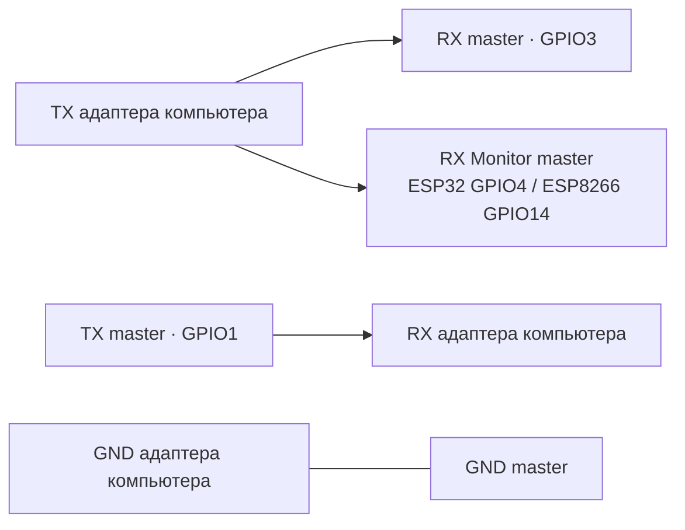

# Сборка, подключение и измерения

[English version](DEVELOPMENT.md) · [Обзор проекта](../README.RU.md) · [Протокол](ARCHITECTURE.RU.md)

## Сборка и прошивка

Сборка использует PlatformIO Core **6.2.0**, Espressif32 **6.12.0** (Arduino **2.0.17**), Espressif8266 **4.2.1** (Arduino **3.1.2**), EncButton **3.7.6** и GyverIO **1.4.2**. Версии закреплены в [`platformio.ini`](../platformio.ini); версия Core — в CI. Текущая прошивка использует API LEDC и callback ESP-NOW из Arduino 2 для ESP32.

Команды из корня репозитория для Python 3:

```bash
python3 -m venv .venv
source .venv/bin/activate
python -m pip install platformio==6.2.0
pio run
```

В Windows для активации в PowerShell используется `.venv\Scripts\Activate.ps1`. `pio run` собирает все шесть environments. Отдельная сборка выбирается командой `pio run -e s2mini`.

| Сборка | Плата PlatformIO | Вариант |
|---|---|---|
| `s2mini`, `s2mini_debug` | `lolin_s2_mini` | ESP32-S2 Mini |
| `esp32`, `esp32_debug` | `esp32dev` | Классический ESP32 DevKit |
| `esp8266`, `esp8266_debug` | `nodemcuv2` | ESP8266 NodeMCU |

Порты задаются локально; настройки COM-портов не хранятся в общей конфигурации:

```bash
pio device list
pio run -e s2mini -t upload --upload-port /dev/ttyACM0
pio run -e esp8266 -t upload --upload-port /dev/ttyUSB0
```

Для Windows используется `--upload-port COM8` или другой найденный порт. После прошивки S2 может появиться под другим именем порта. Если загрузчик недоступен, процедура BOOT/reset платы переводит её в режим USB-загрузчика.

Сборки `_debug` включают диагностику. Сообщения идут в `Serial`, который также передаёт данные: USB CDC на S2, UART0 на ESP32/ESP8266. Терминал открывается командой `pio device monitor --port /dev/ttyACM0 --baud 115200`; для UART скорость терминала должна совпадать с текущей. Перед измерением loopback терминал закрывается.

## Подключение

Для первого запуска S2 master подключается к компьютеру по USB, ESP32/ESP8266 slave — к устройству по UART.

| Сигнал | ESP32 slave | ESP8266 slave | Подключение устройства |
|---|---|---|---|
| TX | GPIO1 | GPIO1 / TX | RX устройства |
| RX | GPIO3 | GPIO3 / RX | TX устройства |
| Земля | GND | GND | GND устройства |
| Кнопка | GPIO0 | GPIO0 / FLASH | Кнопка платы, активный низкий уровень |
| Статусный LED | GPIO15, активный высокий | GPIO2, активный низкий | При необходимости внешний LED с резистором на ESP32 |

У S2 кнопка использует GPIO0, статусный LED — GPIO15; может потребоваться внешний светодиод. RX Monitor на S2 не используется. Обозначения платы вроде `D4` отличаются от номеров GPIO; в таблице везде приведены GPIO.

Уровни UART — **3,3 В**. Перед соединением с UART на 5 В нужно согласование уровней. USB-разъём устройства не является интерфейсом UART. На ESP32/ESP8266 UART0 также соединён со встроенным USB-UART адаптером. TX устройства и TX адаптера не должны одновременно управлять линией RX ESP; требуется отключение сигнала адаптера или питание, при котором он неактивен. UART0 может выдавать загрузочные сообщения, поэтому устройство, чувствительное к командам, подключается после запуска.

Для **UART master** TX адаптера компьютера соединяется одновременно с GPIO3 и RX Monitor: **GPIO4 у ESP32**, **GPIO14 у ESP8266**. RX компьютера соединяется с GPIO1; GND — общий. RX Monitor требует отдельного физического провода и не переназначает UART RX. Логика скорости slave его не использует. Для UART master действуют [ограничения определения скорости](ARCHITECTURE.RU.md#работа-со-скоростью).



## Измерение loopback

Тракт измерения: компьютер → USB S2 → ESP-NOW → TX UART slave → физическая перемычка → RX UART slave → ESP-NOW → компьютер. Он проверяет полный путь в обе стороны без программы на целевом устройстве.

1. На платах используются обычные прошивки `s2mini` и `esp32`/`esp8266`. При сопряжении нажатие выполняется на **S2**, когда её LED мигает двойными вспышками.
2. Целевое устройство отключается. На slave соединяются **GPIO1 TX и GPIO3 RX**. Его USB-UART адаптер не должен управлять той же линией RX.
3. В отчёте указываются ревизии плат, коммит прошивки, расстояние, питание и радиообстановка. Измерительная зависимость устанавливается в активированное окружение:

   ```bash
   python -m pip install -r scripts/requirements-loopback.txt
   ```

4. Команда измерения; названия плат и заметки заменяются данными реального стенда:

   ```bash
   python scripts/uart_loopback.py \
     --port /dev/ttyACM0 --baud 115200 --bytes 65536 \
     --chunk 128 --timeout 2 --seed 1 \
     --master 'ESP32-S2 Mini; firmware commit' \
     --slave 'ESP8266 NodeMCU; firmware commit' \
     --notes 'Board revisions, distance, power and radio conditions' \
     --output measurements/loopback-115200.json
   ```

В примере переносы строк Bash; в PowerShell команда выполняется одной строкой. После открытия порта скрипт ждёт **2 секунды**, удаляет входные сообщения запуска, затем отправляет воспроизводимые двоичные блоки. Параметр `--startup-delay` меняет ожидание. Каждый блок должен полностью вернуться до отправки следующего. Несовпадение, потеря байта, ошибка записи или лишний хвост останавливают запуск с кодом 1 и отчётом об ошибке. Последняя проверка лишних байтов по умолчанию длится **50 мс** (`--quiet-time`).

| Поле JSON | Значение |
|---|---|
| `setup` / `settings` | Платы, компьютер, время, ПО и параметры передачи |
| `transmitted_bytes` / `received_bytes` | Байты, принятые записью serial / прочитанные обратно |
| `successful_bytes` | Байты в полностью совпавших блоках |
| `payload_sha256` / `received_sha256` | Хеш полного подготовленного набора данных / фактически принятого потока |
| `chunk_rtt_ms` | Минимум, медиана и p95 времени прохождения блока туда и обратно, p95 по ближайшему рангу |
| `useful_echo_bytes_per_second` | Полностью проверенные байты, делённые на длительность передачи |
| `status` / `error` | Результат и первая ошибка |

RTT включает оба радионаправления и последовательную передачу UART при возврате. Полезная скорость учитывает каждый вернувшийся байт один раз; блоки передаются с ожиданием ответа. Начальная пауза и последняя проверка хвоста исключены из времени. Измеряется этот режим нагрузки с заданными таймаутом и окном наблюдения. Для каждой выбранной скорости проводятся повторные запуски с одинаковыми объёмом, размером блока и seed; сохраняются успешные и неуспешные отчёты. Таблица результатов может содержать пару плат, baud, объём, принятые/проверенные байты, медиану/p95 RTT и полезные байты/с со ссылками на исходный JSON.

Для проверки восстановления запуск на скорости, отличной от начальной, повторяется после перезапуска slave. Отключение партнёра больше чем на 35 секунд должно включить индикацию offline; пара сохраняется и восстанавливает обмен после возвращения партнёра. Эти проверки требуют физических плат; в репозитории пока есть процедура и инструмент, без записанных аппаратных измерений.

## Автоматические проверки

```bash
python3 tests/run_host_tests.py
python3 -m unittest discover -s scripts -p 'test_*.py'
git diff --check
```

Проверкам прошивки нужны компилятор C++ (`c++` либо путь в `CXX`) и Python 3. Они компилируют настоящий `src/main.cpp` с имитацией периферии ESP32 UART и ESP8266. **51 проверка** охватывает восстановление состояния, смену скорости master, фильтрацию партнёра, границы/кодирование пакетов, поиск, offline, PWM и порядок инициализации. USB и временные характеристики радиообмена проверяются на устройствах. У loopback-инструмента есть **13 тестов** частичного чтения/записи, таймаута, искажения, лишних байтов и CLI; последовательный порт для них не нужен.

[CI](../.github/workflows/firmware.yml) выполняет эти проверки и собирает все шесть environments. Он сохраняет артефакты каждой сборки.

## Диагностика

| Симптом | Что проверить |
|---|---|
| Нет двойных вспышек | GPIO и полярность LED, питание обеих плат; удержание 3 с удаляет старые пары |
| Неверная роль | Удаление пары на обеих платах и нажатие на S2 у компьютера при подтверждении |
| Пара установлена, байты не возвращаются | Перекрёстные TX/RX, общий GND, скорость устройства либо перемычка TX–RX slave для loopback |
| Двоичный поток искажён | Обычная сборка, отсутствие других serial-клиентов, логические уровни и конфликт USB-UART |
| Изменение скорости UART master пропущено | Провод RX Monitor и ограничения определения; S2 передаёт USB line coding напрямую |
| Быстрое мигание примерно через 35 с | Питание партнёра и радиоканал; пара остаётся сохранённой |
| Сборка падает после изменения зависимостей | Закреплённые версии, затем `pio run -t clean` и повторная сборка |
