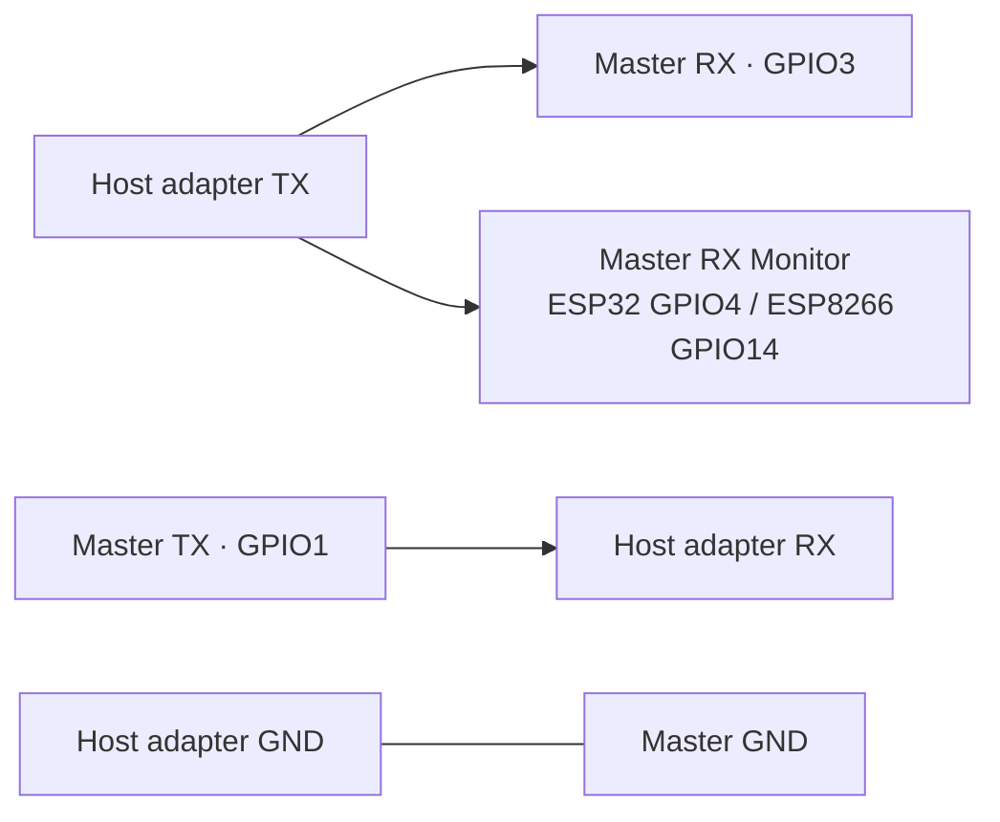

# Build, wiring and measurements

[Русская версия](DEVELOPMENT.RU.md) · [Project overview](../README.md) · [Protocol](ARCHITECTURE.md)

## Build and upload

The build uses PlatformIO Core **6.2.0**, Espressif32 **6.12.0** (Arduino **2.0.17**), Espressif8266 **4.2.1** (Arduino **3.1.2**), EncButton **3.7.6** and GyverIO **1.4.2**. Versions are pinned in [`platformio.ini`](../platformio.ini); the Core version is pinned in CI. The current firmware uses the Arduino 2 ESP32 LEDC and ESP-NOW callback APIs.

From the repository root, using Python 3:

```bash
python3 -m venv .venv
source .venv/bin/activate
python -m pip install platformio==6.2.0
pio run
```

On Windows the activation command is `.venv\Scripts\Activate.ps1` in PowerShell. `pio run` builds all six environments. A single target can be selected with `pio run -e s2mini`.

| Environment | PlatformIO board | Variant |
|---|---|---|
| `s2mini`, `s2mini_debug` | `lolin_s2_mini` | ESP32-S2 Mini |
| `esp32`, `esp32_debug` | `esp32dev` | Classic ESP32 DevKit |
| `esp8266`, `esp8266_debug` | `nodemcuv2` | ESP8266 NodeMCU |

These are ready-made configurations, independent of the master/slave role. ESP32-S2 was used for testing. Other suitable ESP boards can use the same firmware with the matching PlatformIO platform and `board` setting; button, LED and RX Monitor GPIOs are set in [`src/main.cpp`](../src/main.cpp). Native USB CDC is optional: ESP32/ESP8266 can be master through a built-in or external USB–UART adapter.

Ports are selected locally, with no committed COM-port setting:

```bash
pio device list
pio run -e esp32 -t upload --upload-port /dev/ttyUSB0
pio run -e esp8266 -t upload --upload-port /dev/ttyUSB1
```

The example uses an ESP32 and an ESP8266; either may be master. For the S2 Mini native USB variant, use `-e s2mini` and its detected port, such as `/dev/ttyACM0`. Windows examples use `--upload-port COM8` or another detected port. S2 may enumerate with a different port after flashing. If upload cannot find it, the board's BOOT/reset procedure enters its USB bootloader.

Use `_debug` environments for diagnostics. Messages use `Serial`, which is also the data port: USB CDC on S2, UART0 on ESP32/ESP8266. A terminal can be opened with `pio device monitor --port /dev/ttyACM0 --baud 115200`; on UART, the selected terminal rate must match the active rate. Close the terminal before running the loopback tool.

## Wiring

The host-side board can use native USB CDC or a built-in/external USB–UART adapter. The target-side board needs a UART data port for the wiring below. The board model does not assign the master/slave role; confirm the host-side board during pairing.

| Signal | ESP32 slave | ESP8266 slave | Target connection |
|---|---|---|---|
| TX | GPIO1 | GPIO1 / TX | Target RX |
| RX | GPIO3 | GPIO3 / RX | Target TX |
| Ground | GND | GND | Target GND |
| Button | GPIO0 | GPIO0 / FLASH | On-board button, active-low |
| Status LED | GPIO15, active-high | GPIO2, active-low | External LED with resistor on ESP32 if needed |

S2 uses GPIO0 for the button and GPIO15 for status LED; an external LED may be needed. RX Monitor is unused on S2. Board labels such as `D4` are not GPIO numbers; the table uses GPIO numbers throughout.

UART signals use **3.3 V logic**. A 5 V UART needs level conversion before connection to the ESP pins. A target USB connector is not a UART interface. On ESP32/ESP8266 development boards, UART0 is also connected to the on-board USB-UART adapter. The target TX and adapter TX must not drive the ESP RX line together; isolate the adapter signal or use a power connection that leaves it inactive. UART0 can emit boot messages, so connect a command-sensitive target after boot.

For a **UART master**, wire the host adapter TX to both GPIO3 and RX Monitor: **GPIO4 on ESP32**, **GPIO14 on ESP8266**. Wire host RX to GPIO1 and share GND. RX Monitor is an extra physical wire, rather than the UART RX configuration. It is unused by the slave's baud logic. The [baud-detection limits](ARCHITECTURE.md#baud-handling) apply to UART masters.



## Loopback measurement

The measurement path is host → master serial port → ESP-NOW → slave UART TX → physical jumper → slave UART RX → ESP-NOW → host. The master can use native USB CDC or a USB–UART adapter. It exercises the complete bidirectional data path without a target application.

1. Flash release builds for the selected boards and pair them, clicking the **host-side board's** button when it double-blinks. For a UART master, connect RX Monitor as described above.
2. Disconnect the target. Join **GPIO1 TX to GPIO3 RX on the slave**. Ensure its USB-UART adapter does not drive the same RX line.
3. Record board revisions, firmware commit, distance, power and radio conditions. Install the measurement dependency in the activated environment:

   ```bash
   python -m pip install -r scripts/requirements-loopback.txt
   ```

4. Run a capture, replacing board labels, port and notes with the actual setup. The command illustrates the S2 test board; the procedure also works with a UART master:

   ```bash
   python scripts/uart_loopback.py \
     --port /dev/ttyACM0 --baud 115200 --bytes 65536 \
     --chunk 128 --timeout 2 --seed 1 \
     --master 'ESP32-S2 Mini; firmware commit' \
     --slave 'ESP8266 NodeMCU; firmware commit' \
     --notes 'Board revisions, distance, power and radio conditions' \
     --output measurements/loopback-115200.json
   ```

The example uses Bash line continuations; PowerShell can run the command on one line. The script waits **2 seconds** after opening the port, discards startup input, then sends deterministic binary blocks. `--startup-delay` changes that wait. Each block must echo completely before the next is sent. A mismatch, missing byte, write failure or unexpected tail stops the run with exit code 1 and a failure report. The default final tail check lasts **50 ms** (`--quiet-time`).

| JSON field | Meaning |
|---|---|
| `setup` / `settings` | Boards, host, timestamp, software and transfer parameters |
| `transmitted_bytes` / `received_bytes` | Bytes accepted by serial writes / read back |
| `successful_bytes` | Bytes in fully matching echo blocks |
| `payload_sha256` / `received_sha256` | Full generated payload hash / actually received stream hash |
| `chunk_rtt_ms` | Minimum, median and nearest-rank p95 block round-trip time |
| `useful_echo_bytes_per_second` | Fully verified bytes divided by transfer duration |
| `status` / `error` | Result and first failure |

RTT includes both radio directions and UART echo serialization. Throughput counts each echoed byte once and uses stop-and-wait blocks; startup delay and the final tail check are excluded. It measures this workload, with a bounded timeout and observation window. Repeat runs at each chosen baud with the same payload size, chunk and seed; retain failed reports as well as successful ones. A useful result table lists board pair, baud, payload, received/verified bytes, RTT median/p95 and useful bytes/s, with links to raw JSON.

For recovery checks, repeat a nondefault-baud run after rebooting the slave. Turn a peer off for over 35 seconds and confirm that the remaining board indicates offline, retains its pair and reconnects on peer return. These checks require physical boards; the repository currently provides the procedure and tool, with no published quantitative hardware measurements.

## Automated checks

```bash
python3 tests/run_host_tests.py
python3 -m unittest discover -s scripts -p 'test_*.py'
git diff --check
```

The firmware harness needs a C++ compiler (`c++`, or `CXX` set to its path) and Python 3. It compiles the actual `src/main.cpp` against fake ESP32 UART and ESP8266 peripherals. **51 checks** cover saved-state recovery, master baud changes, peer filtering, packet boundaries/codec, discovery, offline behavior, PWM and initialization order. These host checks leave USB enumeration and radio timing to physical tests. The loopback tool has **13 unit tests** for partial reads/writes, timeout, corruption, extra bytes and CLI behavior, with no serial hardware dependency.

[CI](../.github/workflows/firmware.yml) runs these checks before building all six environments in two platform jobs. It runs on pushes to `main`, pull requests and manual dispatch; changes limited to Markdown, `docs/`, README assets or the license skip automatic runs.

Toolchain caches are shared by release/debug builds and saved only from `main`. Pushes to `main` and manual runs upload two archives, `firmware-espressif32` and `firmware-espressif8266`, retained for **7 days**. Each archive keeps the BIN/ELF files in environment-named folders; PRs validate all six builds without uploading archives.

## Troubleshooting

| Symptom | Check |
|---|---|
| No double-blink | Button/LED GPIO and LED polarity; power both boards; hold 3 s to clear old pairs |
| Wrong role | Clear the pair on both boards and click the host-side board during confirmation |
| Paired, no returned bytes | Crossed TX/RX, common GND, correct target baud, or TX–RX jumper on slave for loopback |
| Corrupt binary stream | Use a release build, disconnect other serial clients, check logic levels and USB-UART contention |
| UART host speed change is missed | Check RX Monitor wiring and detection limits; native USB CDC reports the requested rate directly |
| Fast blink after about 35 s | Check peer power and radio channel; the pair remains stored |
| Build fails after dependency changes | Use pinned versions, then `pio run -t clean` and rebuild |
